# Sereno SP — App Mobile (Mobile Development & IoT)

**Integrantes:** Luan Orllandeli (RM554747) · Jorge Luiz (RM554418) · Arthur Bobadilla (RM555056)

> Global Solution 2026.2 · FIAP · Engenharia de Software · CitizenTech
> App em **React Native + TypeScript + Expo (SDK 58) + Expo Router + expo-sqlite**, integrado à **Sereno.Api** (.NET 10) já desenvolvida pela equipe.

---

## Ficha da CitizenTech

| Campo | Conteúdo |
|---|---|
| **Nome da CitizenTech** | Sereno SP |
| **Cidade e bairro** | São Paulo (SP) – distrito de Santana, zona norte |
| **Cidadão beneficiado** | Idosos (60+), especialmente os que moram sozinhos, e trabalhadores de rua (ambulantes, entregadores, agentes de limpeza) expostos ao sol |
| **Problema, em uma frase** | Em dias de calor extremo, idosos e trabalhadores de rua de Santana não sabem com antecedência quando o risco aumenta nem onde encontrar sombra e água por perto. |
| **Como funciona** | Um totem com sensor mede temperatura e umidade na praça, calcula o índice de calor e acende luz verde, amarela ou vermelha. A leitura vai para um servidor, que também recebe a previsão de um modelo de Machine Learning treinado com dados reais do INMET. Pelo app, o cidadão vê o nível de calor agora, o aviso de véspera e os pontos de refresco mais próximos, mesmo sem internet. |
| **O que cada parte faz** | **Totem ESP32** (Physical Computing): mede, alerta no local e envia a leitura · **API C#/.NET** (SOA e C#): recebe leituras e previsões, gera alertas e guarda no banco · **Modelo de ML**: prevê se amanhã será dia de calor extremo (INMET A701) · **App Expo (esta entrega)**: mostra nível, previsão e pontos de refresco; guarda check-ins e favoritos no celular · **Sereno Guard** (Cybersecurity): detecta e bloqueia vazamento de dados pessoais · **Servidor Linux** (OS) · **Azure Boards** (Testing) |
| **Link do repositório** | https://github.com/naboix/sereno-sp-mobile |
| **Indicador de impacto** | Percentual de dias de calor extremo avisados na véspera (recall do modelo de ML; meta ≥ 80%). No app: percentual de alertas seguidos de ação protetiva registrada (check-in "Bebi água" ou consulta a ponto de refresco em até 2 h) — linha de base a medir em piloto. |
| **ODS conectados** | ODS 3 (Saúde e bem-estar) · ODS 10 (Redução das desigualdades) · ODS 11 (Cidades sustentáveis) · ODS 13 (Ação contra a mudança do clima) |

### Integrantes

| Nome | RM |
|---|---|
| Luan Orllandeli | RM554747 |
| Jorge Luiz | RM554418 |
| Arthur Bobadilla | RM555056 |

**Vídeo (até 3 min):** https://youtu.be/jwhmVcqD24g 

---

## Jornada do cidadão atendida

Persona da proposta: **Dona Lúcia, 72 anos** (hipotética).

1. **Onboarding:** informa só apelido, faixa de idade e bairro, escolhe o tamanho da letra e autoriza guardar no celular.
2. **Início:** vê o **nível de calor agora** (dado do totem via API), temperatura, umidade, sensação de calor, horário da medição e uma orientação simples.
3. **Amanhã:** vê o **aviso de véspera** ("Amanhã: calor perigoso") com a chance em %.
4. **Onde me refrescar:** abre os **pontos com sombra e água mais próximos**, com distância, e salva favoritos.
5. **Cuidado:** toca **"Bebi água"**; o registro fica no celular (funciona sem internet) e o app sugere o horário do próximo copo.
6. **Sem internet:** o app mostra os **últimos dados salvos com data e hora**, deixando claro que não são atuais.

---

## Telas e navegação (Expo Router)

```
src/app/
├── _layout.tsx            Stack raiz + SQLiteProvider (migrações) + AppProvider
├── index.tsx              Redireciona: sem perfil → onboarding; com perfil → Início
├── onboarding.tsx         Boas-vindas + cadastro mínimo com consentimento
├── (tabs)/_layout.tsx     4 abas com ícone + texto
│   ├── inicio.tsx         Calor agora · Amanhã · Bebi água
│   ├── pontos.tsx         Pontos próximos · filtro · favoritos
│   ├── alertas.tsx        Alertas de agora · histórico local
│   └── perfil.tsx         Perfil · fonte · contraste · lembrete · privacidade · conexão
├── ponto/[id].tsx         Detalhe do ponto (rota dinâmica) · mapa · favoritar
└── hidratacao.tsx         Histórico de "Bebi água"
```

| Print | Tela |
|---|---|
| 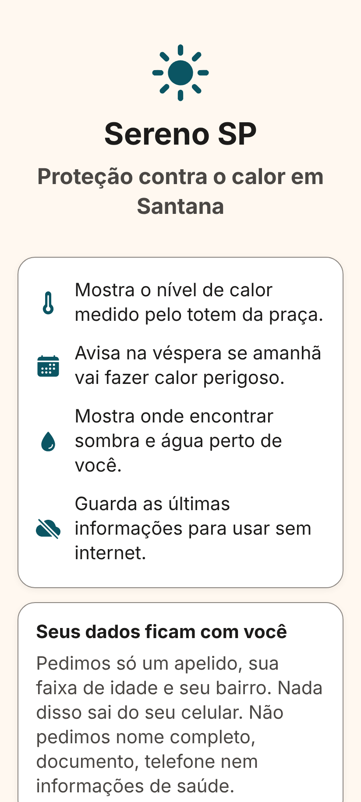 | 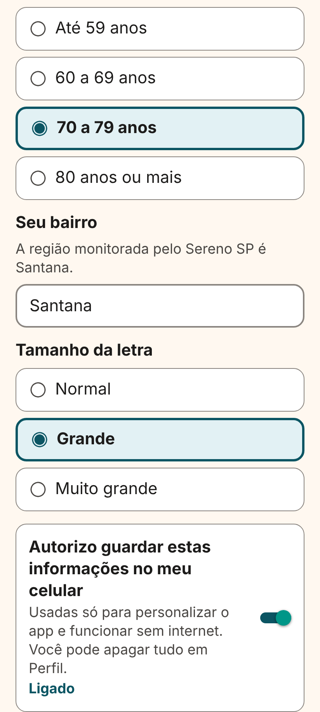 |
| 01 Onboarding | 03 Perfil mínimo + consentimento |
| 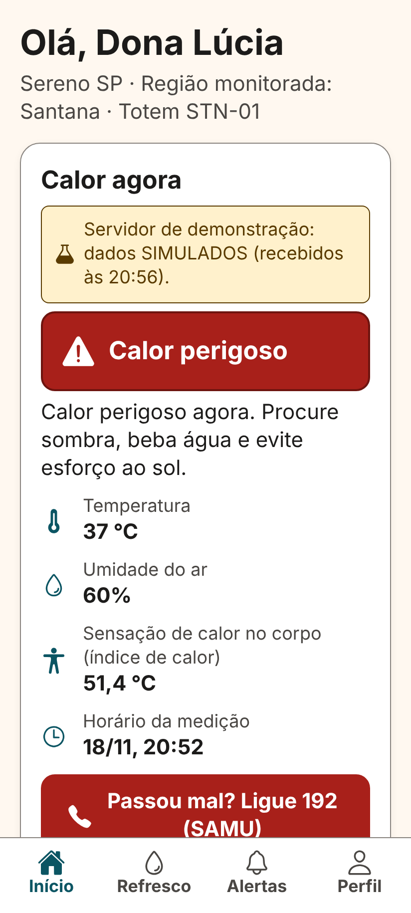 | 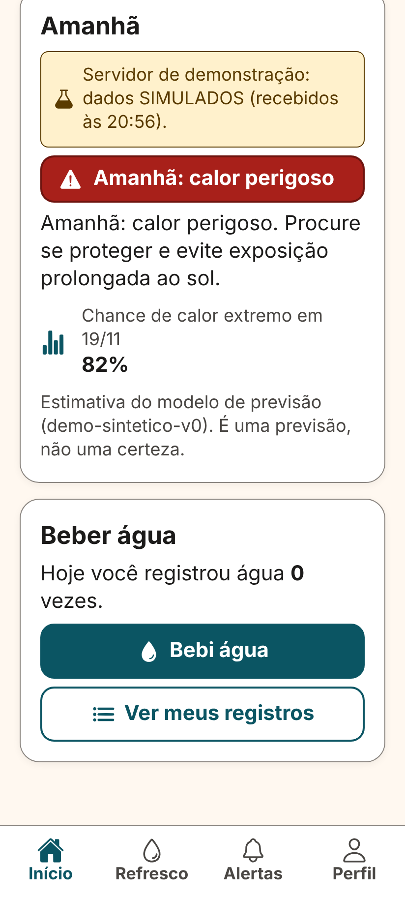 |
| 04 Início — calor perigoso | 04b Previsão de amanhã |
| 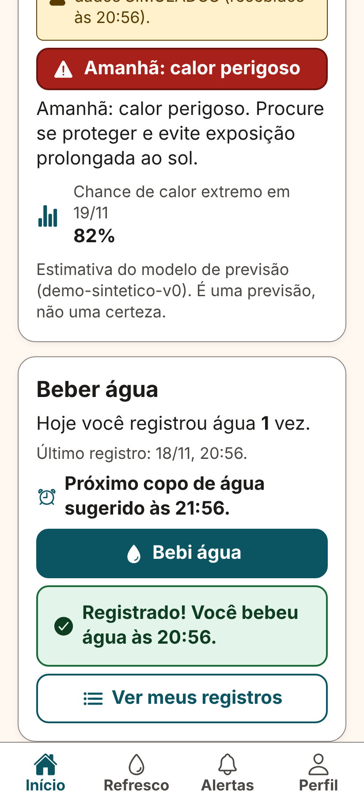 | 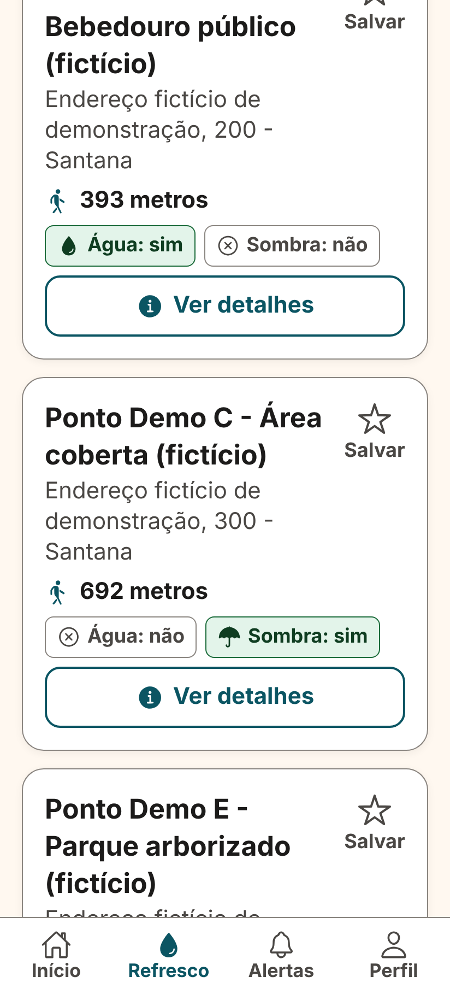 |
| 05 "Bebi água" confirmado | 06b Pontos mais próximos |
| 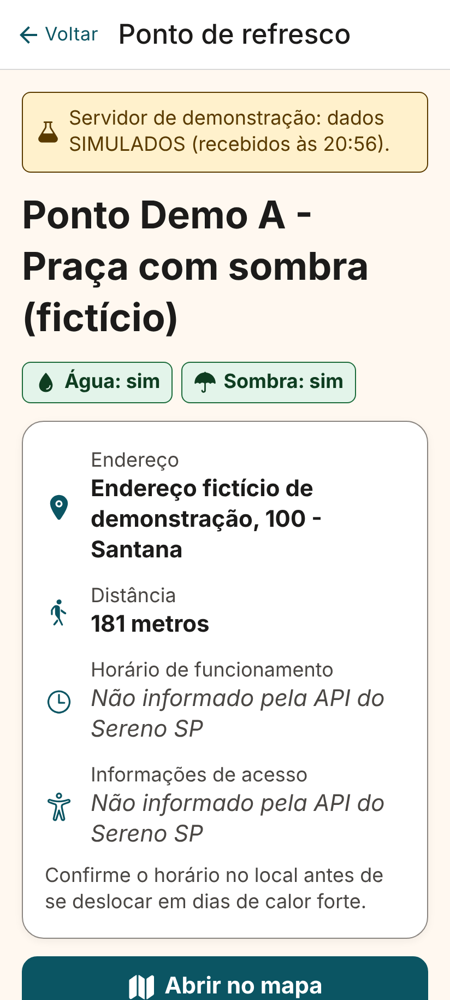 | 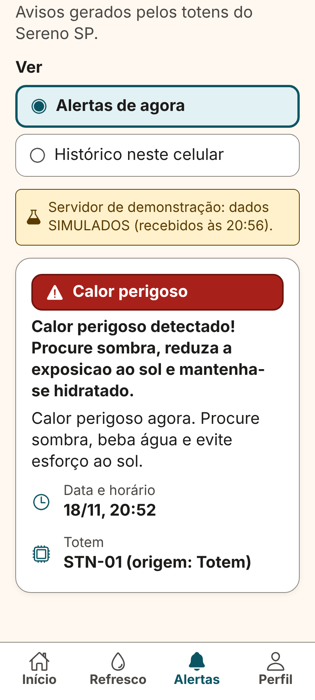 |
| 07 Detalhe do ponto | 08 Alertas vigentes |
| 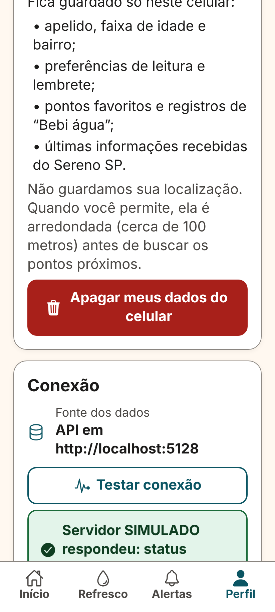 | 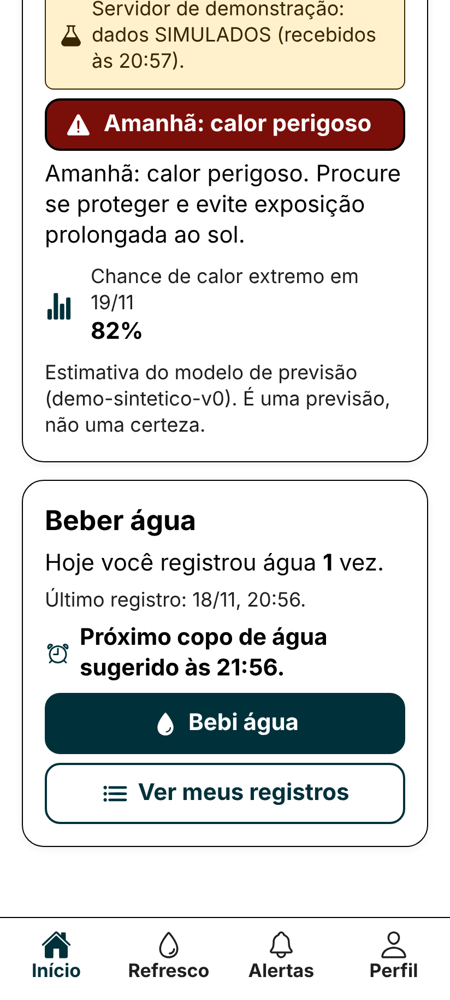 |
| 10 Perfil e preferências | 11 Fonte muito grande + contraste reforçado |
| 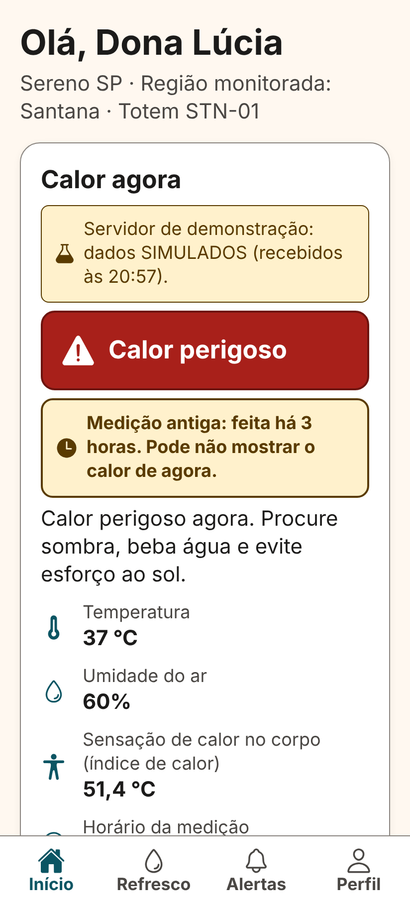 | 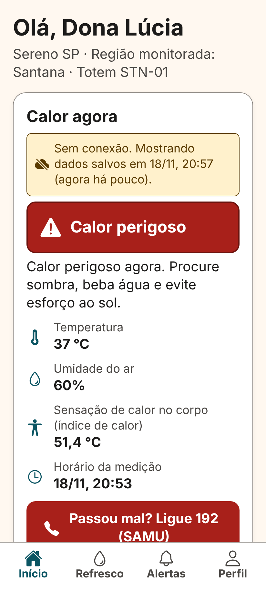 |
| 12 Aviso de medição antiga | 14 Sem conexão: dados salvos com horário |

Todos os 18 prints estão em [`docs/prints/`](docs/prints). **Origem dos prints:** build web real do app (`expo export -p web`) aberta no Chrome (viewport 412×915), consumindo o **servidor de contrato simulado** (dados sintéticos). Por isso as telas exibem a faixa *"Servidor de demonstração: dados SIMULADOS"*. Com a Sereno.Api real, a faixa muda para *"Dados recebidos do Sereno SP às HH:MM"*.

---

## Consumo de dados — integração com a Sereno.Api

Todos os endpoints foram confirmados lendo os controllers e DTOs do backend. Detalhes, tratamento de erros e diferenças em [`docs/INTEGRACAO_API.md`](docs/INTEGRACAO_API.md).

| Endpoint (real) | Tela |
|---|---|
| `GET /api/totens` | Início (escolhe o totem ativo) |
| `GET /api/leituras/ultima?totemCodigo=` | Início |
| `GET /api/previsoes/amanha` | Início |
| `GET /api/alertas?ativos=true` | Alertas |
| `GET /api/pontos/proximos?lat=&lon=&limite=` | Pontos |
| `GET /api/pontos/{id}` | Detalhe do ponto |
| `GET /health` | Perfil → Testar conexão |

- Camada única: [`src/services/serenoApi.ts`](src/services/serenoApi.ts) (as telas nunca chamam `fetch`).
- Timeout configurável, erros traduzidos para o cidadão, **validação do contrato em tempo de execução** ([`contratos.ts`](src/services/contratos.ts)).
- **Origem do dado sempre visível:** `api` (ao vivo) · `simulado` (servidor de demonstração) · `mock` (dados embutidos) · `cache` (salvo no celular, com data e hora).
- **Privacidade:** a localização é arredondada para ~100 m antes de ir para a URL e nunca é gravada.

## Banco de dados local (expo-sqlite)

[`src/db/database.ts`](src/db/database.ts) (migração versionada por `PRAGMA user_version`) e [`src/db/repositorios.ts`](src/db/repositorios.ts) (CRUD com parâmetros `?`).

| Tabela | Uso |
|---|---|
| `perfil` | apelido, faixa etária, bairro, consentimento |
| `preferencias` | tamanho da letra, contraste, vibração, lembrete |
| `favoritos` | cópia do ponto para uso offline |
| `checkins` | registros de "Bebi água" |
| `cache_api` | últimas respostas da API, com origem e horário |
| `alertas_historico` | alertas vistos (vigentes e encerrados) |

Minimização: **não há** colunas para CPF, telefone, e-mail, saúde ou GPS do usuário (verificado em teste).

## Acessibilidade

Resumo (detalhes e o que depende de teste manual em [`docs/ACESSIBILIDADE.md`](docs/ACESSIBILIDADE.md)):

- Texto-base de 18 pt, escala do sistema **e** escala própria (Normal, Grande, Muito grande).
- Contraste WCAG AA (≥ 4,5:1) **verificado por teste automatizado** em todas as combinações, nos dois temas.
- Botões com altura mínima de 56, ícones sempre acompanhados de texto.
- Risco indicado por **cor + ícone + texto**.
- `accessibilityRole`, `accessibilityLabel`, `accessibilityState`, `accessibilityLiveRegion` e anúncio por leitor de tela nas confirmações.
- Estados de carregando, erro com "Tentar de novo", vazio e sem conexão em todas as telas.

---

## Como rodar

**Pré-requisitos:** Node **22.18+** · app **Expo Go** atualizado no celular (SDK 58).

```bash
npm install
cp .env.example .env        # ajuste EXPO_PUBLIC_API_URL (ver abaixo)
npm start                   # abra o QR code no Expo Go
```

### Opção A — com a Sereno.Api real (recomendado para a avaliação)

```bash
# no repositório do backend (Windows/Linux/macOS)
dotnet ef database update --project Sereno.Infrastructure --startup-project Sereno.Api
dotnet run --project Sereno.Api --launch-profile http      # http://localhost:5128
# nesta pasta: cadastra dados SINTÉTICOS pela própria API (pontos fictícios, totens, leituras, previsão)
SERENO_API_URL=http://localhost:5128 npm run api:seed
```

| Onde o app roda | `EXPO_PUBLIC_API_URL` |
|---|---|
| Emulador Android | `http://10.0.2.2:5128` |
| Simulador iOS / navegador | `http://localhost:5128` |
| Celular físico (Expo Go) | `http://<IP-do-PC-na-rede>:5128` (mesmo Wi-Fi; libere a porta no firewall) |

Use o perfil **`http`**. O perfil `https` redireciona para um certificado de desenvolvimento que o celular não aceita. No celular físico, a API precisa escutar na rede: `dotnet run --project Sereno.Api --launch-profile http --urls http://0.0.0.0:5128`.

### Opção B — servidor de contrato simulado (sem .NET)

```bash
npm run api:simulada        # mesmas rotas da Sereno.Api, dados sintéticos, porta 5128
# trocar cenário ao vivo (útil no vídeo): perigo | atencao | normal | antiga | sem-leitura | sem-previsao | sem-alertas
curl -X POST "http://localhost:5128/__demo/cenario?nome=antiga"
```

### Opção C — 100% offline

`EXPO_PUBLIC_DATA_MODE=mock` no `.env`: dados simulados embutidos, rotulados na tela.

### Versão web

`npm run web` exige o patch opcional de CORS na API ([`docs/backend-patch-cors/`](docs/backend-patch-cors)), porque o navegador bloqueia chamadas de outra origem. No celular, o patch não é necessário.

---

## Testes e validação

```bash
npm run typecheck    # TypeScript do app e dos testes
npm test             # Jest: 9 suítes, 112 testes
```

| Suíte | O que prova |
|---|---|
| `contraste` | WCAG AA em todos os pares de cor dos dois temas |
| `risco` | rótulos/ícones por nível, medição antiga (> 15 min), lembrete |
| `regrasBackend` | porte fiel das regras do backend (mesmos casos do xUnit) |
| `geo` | arredondamento de privacidade, Haversine |
| `http-contratos` | timeout, sem conexão, 404/503, JSON inválido, contrato dos DTOs, URLs reais |
| `banco` | **SQL real** (SQLite do Node): migração, CRUD, check-ins, cache, histórico, apagar dados |
| `dados` | cache offline com origem, 404 sem cache, previsão vencida descartada |
| `integracao` | HTTP real contra o servidor de contrato: jornada completa da Dona Lúcia |
| `componentes` | roles, rótulos acessíveis, alvo de toque ≥ 56 |

Saídas reais em [`docs/evidencias/`](docs/evidencias). Escopo e pendências em [`docs/TESTES.md`](docs/TESTES.md).

**Pendente (depende da máquina da equipe):** executar o app contra a Sereno.Api .NET real e testar com TalkBack/VoiceOver em aparelho físico. O roteiro está em `docs/TESTES.md`.

## Estrutura

```
src/app/        rotas (telas)            src/services/   API, cache, localização, mock
src/components/ componentes acessíveis   src/db/         SQLite: migração e repositórios
src/domain/     tipos dos DTOs e regras   src/theme/      cores, tipografia, contraste
mock-server/    servidor de contrato SIMULADO           scripts/  seed da API real
__tests__/      testes Jest                docs/           integração, acessibilidade, testes, roteiro, prints
```

## Limitações conhecidas

- Perfil e "Bebi água" ficam só no celular: a Sereno.Api não tem endpoints de cidadão nem de check-in. Não há sincronização fictícia.
- A API não informa o horário de funcionamento nem as informações de acesso dos pontos. O app exibe "Não informado pela API".
- Não há notificações push (o backend não tem esse recurso). O lembrete de água é exibido dentro do app.
- Os pontos do seed são **fictícios**, criados para a demonstração.
- Sem localização, a distância é calculada a partir de um ponto de referência aproximado da região de Santana.

